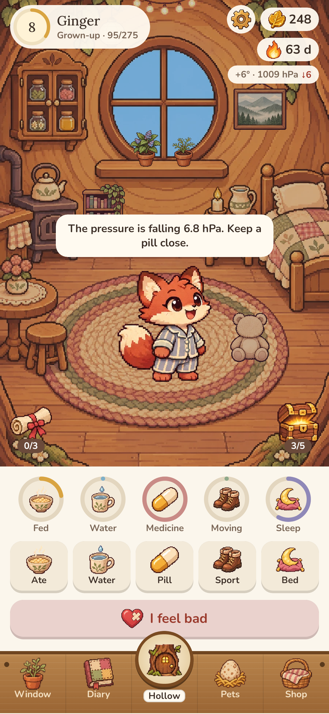
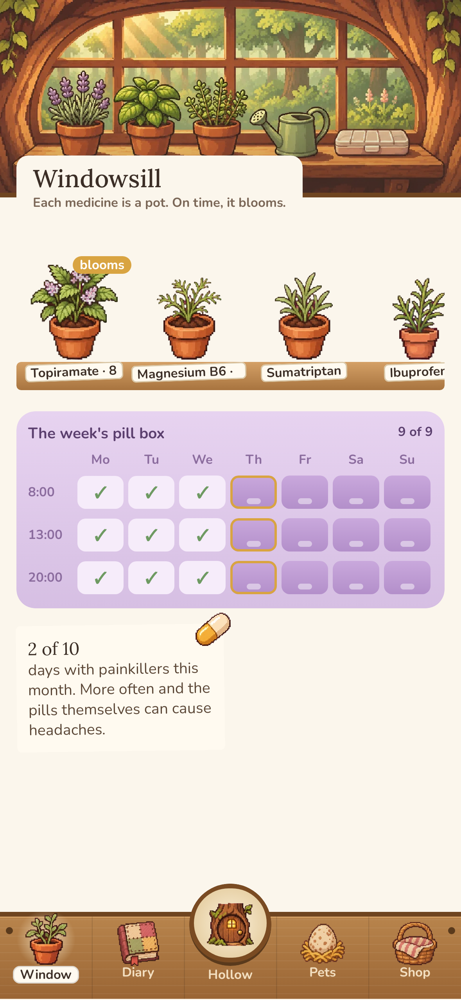
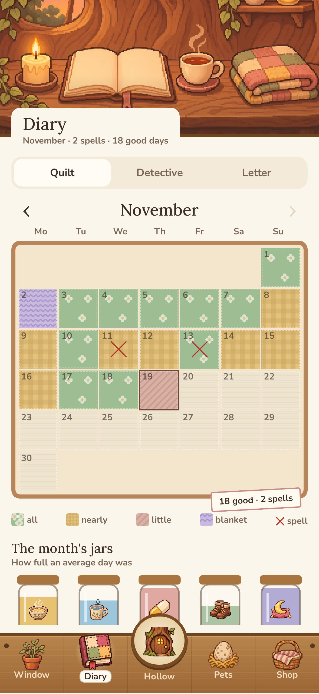

<p align="center"></p>

<h1 align="center">Caregotchi</h1>

<p align="center">A tamagotchi fed by looking after yourself.<br>
<a href="https://bigdevwhale.github.io/stillcraft/apps/caregotchi/">Website</a> · <a href="https://github.com/bigdevwhale/caregotchi/releases/latest/download/Caregotchi.apk">Download APK</a> · <a href="README.ru.md">Русский</a></p>

A little pet lives in the hollow of an old tree. You have breakfast – it eats its porridge; you take a pill – it gets its berry; you go to bed – it curls up. Forget about yourself and it grows glum and catches a cold, and a couple of good days put it back on its feet. Your troubles never hurt it: when you write down a migraine, the pet simply brings a blanket.

<p align="center">



</p>

## Inside

- **Five needs.** Food, water, medicine, moving and sleep. Five quick buttons in the hollow, and the pet eats, drinks or stretches with you.
- **Food and sport without calories.** After a meal one tap says how wholesome it was and whether there were vegetables. Sport is a kind and minutes; a walk to the shop counts too.
- **Medicine on the windowsill.** Each medicine grows in its own pot: on time it blooms, missed it wilts. The reminder comes with a «Taken» button right in the notification. A weekly pill box, the stock and a count of painkiller days.
- **«I feel bad».** Migraine, headache, stomach, back, anxiety, allergy, blood pressure, a cold and your own troubles. For a headache the screen dims to dark red, and strength, where it hurts, symptoms and medicine can be marked almost blind. Two hours later the pet asks: «Feeling better?»
- **Pressure outside.** When the air pressure falls fast, the pet warns you ahead.
- **The detective** compares days with spells and without and brings notes like «3 of 4 spells came after a night shorter than 6 hours». Keep each or strike it out.
- **The diary.** The month is a patchwork quilt, every day has its own page, and on Sundays the pet writes a letter about the week.
- **A report for the doctor** – a 3-month PDF: spells, strength, painkiller days and what helped.
- **The game.** 12 pets, each hatching for its own kind of care. Levels, leaves, a shop for the hollow, daily tasks, a weekly chest and 16 badges.
- **Move to another phone** with one file.
- **No punishment.** The pet never dies. A blanket day counts as good, and strict mode is opt-in.

## Install

Download [Caregotchi.apk](https://github.com/bigdevwhale/caregotchi/releases/latest/download/Caregotchi.apk) on a phone with Android 9 or newer, open it and allow installs from this source when Android asks.

## Privacy

No ads, no account, no analytics. Everything stays on the phone. Only the town's coordinates go online, for the weather and the air pressure. See [PRIVACY.md](PRIVACY.md).

The app is a diary and a friend, not a doctor: your doctor sets doses and treatment.

## Build

JDK 17+ (Android Studio's bundled JBR works) and the Android SDK.

```
git clone https://github.com/bigdevwhale/caregotchi.git
cd caregotchi
./gradlew assembleDebug
./gradlew assembleDebug -Pdemo        # app.caregotchi.demo: two months of records
```

Kotlin, Jetpack Compose, Room, DataStore. The day's care and the pet's state are in `Care.kt`, the game in `Game.kt`, troubles, the detective and the letters in `Troubles.kt`. The pets, the hollow and its things were drawn with an image model (`tools/gen_art.py`, `tools/cut.py`).

## License

MIT. Fonts Nunito and Lora (SIL OFL). Weather by [Open-Meteo](https://open-meteo.com) and [MET Norway](https://api.met.no).

Caregotchi is one of the [StillCraft](https://bigdevwhale.github.io/stillcraft/) apps.
