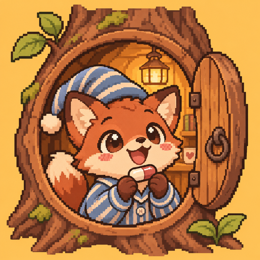
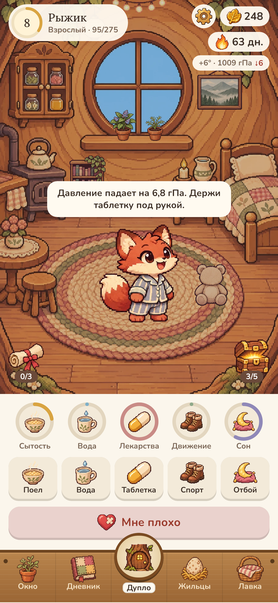
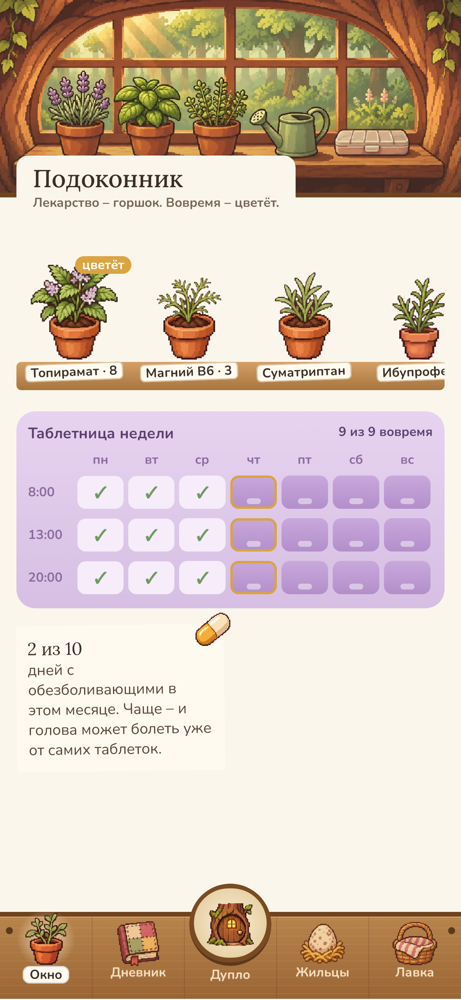
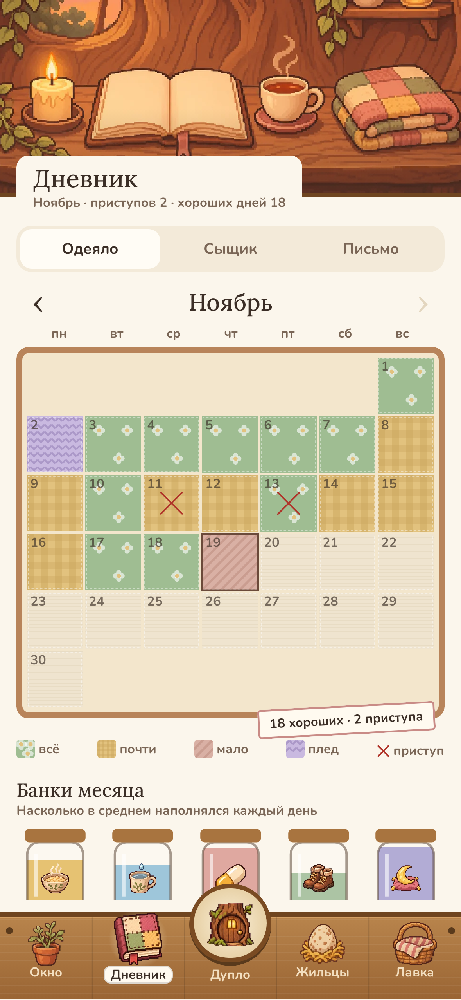

<p align="center"></p>

<h1 align="center">Заботогочи</h1>

<p align="center">Тамагочи, которого кормит ваша забота о себе.<br>
<a href="https://bigdevwhale.github.io/stillcraft/apps/caregotchi/">Сайт</a> · <a href="https://github.com/bigdevwhale/caregotchi/releases/latest/download/Caregotchi.apk">Скачать APK</a> · <a href="README.md">English</a></p>

В дупле старого дерева живёт маленький питомец. Вы позавтракали – он ест кашу, выпили таблетку – получает свою ягодку, легли спать – сворачивается клубком. Если забывать о себе, он грустнеет и простужается, а пара хороших дней снова ставит его на ноги. Ваши болячки ему не вредят: когда вы записываете приступ мигрени, питомец просто приносит плед.

<p align="center">



</p>

## Что внутри

- **Пять потребностей.** Еда, вода, лекарства, движение и сон. В дупле пять быстрых кнопок: нажали – и питомец сразу ест, пьёт или потягивается вместе с вами.
- **Еда и спорт без подсчёта калорий.** После еды можно одним касанием отметить, насколько она была полезной и были ли в ней овощи. Спорт – это вид занятия и минуты, прогулка до магазина тоже считается.
- **Лекарства на подоконнике.** Каждое лекарство растёт в своём горшке: принимаете вовремя – цветёт, пропускаете – вянет. Напоминание с кнопкой «Принял» приходит прямо в уведомлении. Есть таблетница на неделю, запас таблеток и счётчик дней с обезболивающими.
- **«Мне плохо».** Мигрень, головная боль, живот, спина, тревога, аллергия, давление, простуда и свои болячки. При головной боли экран гаснет до тёмно-красного, и силу, место боли, симптомы и выпитое лекарство можно отметить почти вслепую. Через два часа питомец спросит: «Полегчало?»
- **Давление крови.** Утром и вечером питомец напомнит измерить давление, а записать верхнее, нижнее и пульс можно прямо из уведомления. Измерения попадают в дневник и в отчёт для врача.
- **Давление за окном.** Если давление резко падает, питомец заранее предупредит.
- **Сыщик.** Сравнивает дни с приступами и без них и приносит записки вроде «3 из 4 приступов были после ночи короче 6 часов». Каждую можно принять или зачеркнуть.
- **Дневник.** Месяц выглядит как лоскутное одеяло, у каждого дня своя страница, а по воскресеньям питомец пишет письмо о прошедшей неделе.
- **Отчёт для врача** – PDF за три месяца: приступы, их сила, дни с обезболивающими и что помогало.
- **Игра.** 12 питомцев, и каждый вылупляется за свой вид заботы. Уровни, листики, лавка с вещами для дупла, задания на день, сундук недели и 16 нашивок.
- **Перенос на другой телефон** одним файлом.
- **Без наказаний.** Питомец не умирает. День под пледом считается хорошим, а строгий режим включается только по желанию.

## Установка

Скачайте [Caregotchi.apk](https://github.com/bigdevwhale/caregotchi/releases/latest/download/Caregotchi.apk) на телефон с Android 9 или новее, откройте файл и разрешите установку из этого источника, когда Android спросит.

## Приватность

Без рекламы, аккаунта и аналитики. Все записи хранятся только на телефоне. В сеть уходят лишь координаты города, чтобы показать погоду и давление. Подробнее – в [PRIVACY.md](PRIVACY.md).

Приложение – дневник и друг, а не врач: дозы и схемы лечения назначает доктор.

## Сборка

JDK 17+ (подойдёт JBR из Android Studio) и Android SDK.

```
git clone https://github.com/bigdevwhale/caregotchi.git
cd caregotchi
./gradlew assembleDebug
./gradlew assembleDebug -Pdemo        # app.caregotchi.demo: два месяца записей
```

Kotlin, Jetpack Compose, Room, DataStore. Подсчёт дня и состояние питомца – в `Care.kt`, игра – в `Game.kt`, болячки, сыщик и письма – в `Troubles.kt`. Питомцы, дупло и вещи нарисованы нейросетью (`tools/gen_art.py`, `tools/cut.py`).

## Лицензия

MIT. Шрифты Nunito и Lora (SIL OFL). Погода – [Open-Meteo](https://open-meteo.com) и [MET Norway](https://api.met.no).

«Заботогочи» – одно из приложений [StillCraft](https://bigdevwhale.github.io/stillcraft/).
